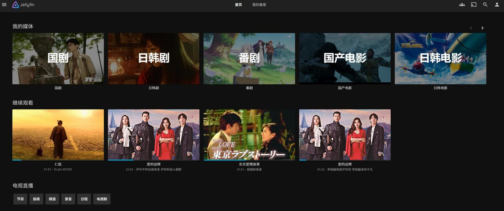
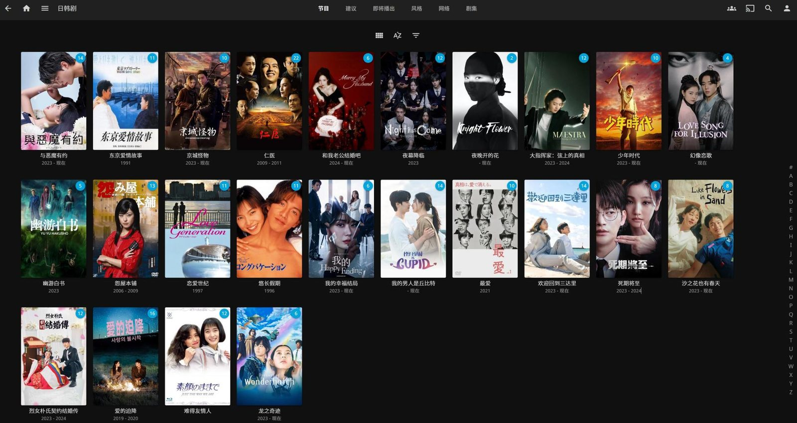
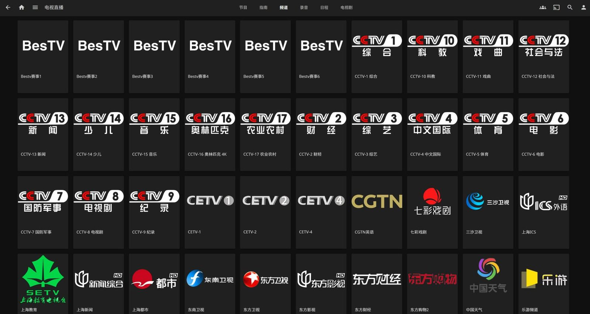

先上效果图。

   

* * *

前几天翻出自己的黑群晖，因为是旧笔记本改的，500G的硬盘实在存不了多少资源，所以想着还不如装个alist挂载阿里云盘来看片好了。 于是说干就干，群晖里docker安装alist相当轻松，装完之后可以挂自己的阿里云盘，也可以套娃小雅的数据，我这里挂了自己的网盘。 部署完alist之后，就该轮到Jellyfin了，起先我在群晖上安装，然后在测试播放影片的时候，发现遇到不支持的格式在软解的情况下十分吃cpu性能，cpu占用90%+，画面也十分劣质。 把Jellyfin的转码硬件加速打开之后，发现无法使用，一查发现我这黑裙没有核显驱动😂 查了一圈教程，发现太折腾了，但随后转念一想Jellyfin也支持windows安装啊，直接本机电脑安装，还能独显硬解，岂不美哉。 最终安装完Jellyfin桌面端配合RaiDrive通过webdav挂载阿里云盘到本地，添加配置好媒体库，终于能够~~愉快而优雅的~~看片啦~😏 当然除了挂载网盘看片，你甚至可以添加m3u直播源来看电视直播。 虽说过程看似简单，实际上还是有不少麻烦的地方。 比如首先你得有一个容量还不错的云盘，否则也存不了多少资源。（我3T多的阿里云盘空间已经被回收的只剩1.8T。） 说好不限速的现在也限速了，会员也整上了，只能说，资本的话听听就好😒 Jellyfin的刮削也得配合梯子才不用额外折腾，少走很多弯路。 以上就是最近的折腾经历，不过弄完我才回过神来发现，我哪有空坐在电脑面前看片啊！ **结论我的评价是：不如IPAD上安装VidHub，一样能webdav挂载网盘，刮削生成漂亮的海报墙，躺在床上更优雅的看片。** 🥱
