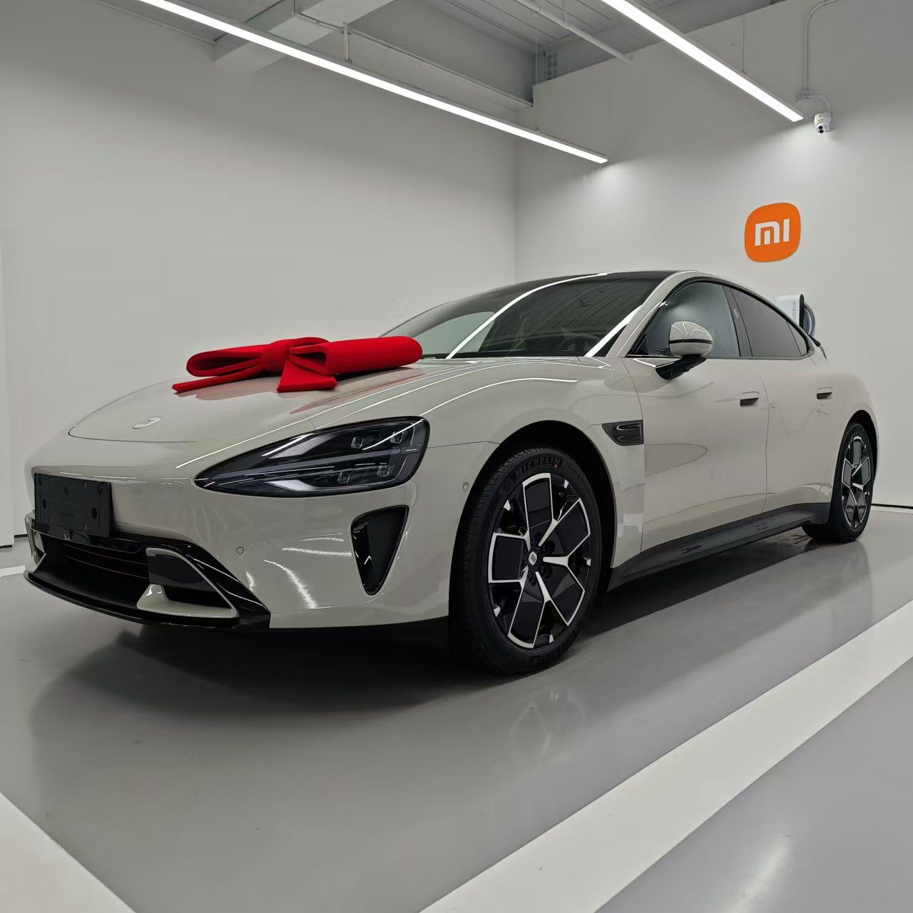
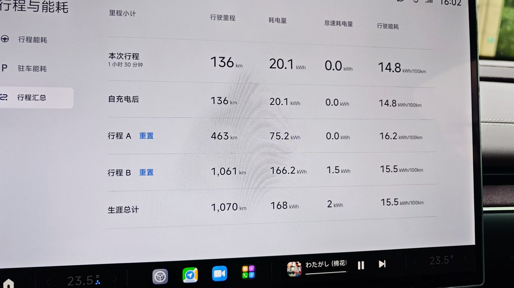
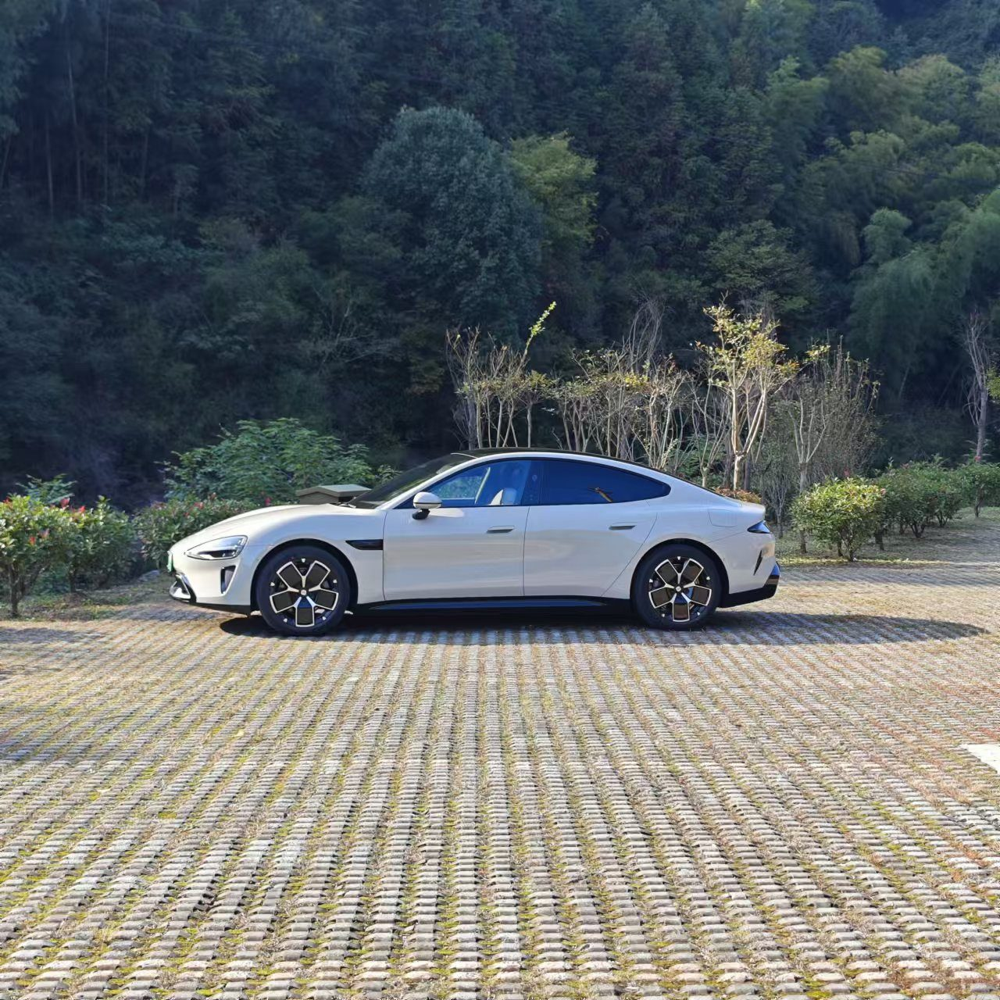

虽说标题是提车记，其实距离22号提车已经过去好几天了。 上半年3月底雷总发布小米su7，我在观望了一个月，等到首批创始版拿到车，看了不少评测后，终于在4月29日锁了订单，三个配置综合考虑自己没有城区智驾的需求，标准版的续航也够我节假日高速回家，最后就选了标准版。 然后就开启了漫长的等待，当时预计是27-30周提车，算下来应该在11月初，中间几次雷总说提速，实际都没看到明显的提速，也许产能都优先给了max版。 终于在上周五通知我车下线了，约了周二提车，整个提车流程很快，给了束鲜花，拍个纪念照，上车解说了基本的功能，半小时不到就结束了。

然后就是上牌了，上海本来是免费送绿牌的，但是我的居住证要11月下旬才能下来，时间来不及就放弃了，选择回老家上牌，正好开个长途熟悉下车。 尽管标准版只是单电机后驱，但是动力响应依然非常快，跟以前开油车的感受完全不能比，在高速上开舒适模式也能很轻松全程保持120码，想超车就多踩点电门，指哪打哪非常舒服。 充满电续航差不多在540km左右，我回家400km，车速对电车续航影响比较大，在保持100~120码的情况下，基本上在高速上是不需要补能直接跑完的。 但是速度上到130码以上后，电量就掉的比较厉害，续航勉强在400km。综合算了下百公里高速的能耗在14~16度电，相当的给力了。

最后关于智能化和智驾。小米的车机非常流畅，开了几天没遇到任何卡顿问题，语音让小爱同学操作解放双手，体验也很好。 由于我的su7是标准版，不带城市NOA智驾的，所以只能在高速上测试了下，结果是**能用，但不能全程使用** 。 我回家高速走的沪渝高速，他并不能全程开启NOA智驾，某些路段依然有断点退回到LCC。 但在开启阶段大部分时间表现的还是比较不错的，能稳定按照当前车道限速行驶，遇到前车速度过慢可超车的情况下，会提示车主进行超车，车主只需要打转向灯确认，车子就会自动变道超车，过程很流畅。 但依然只能说是辅助驾驶，不要太指望能全程解放。

