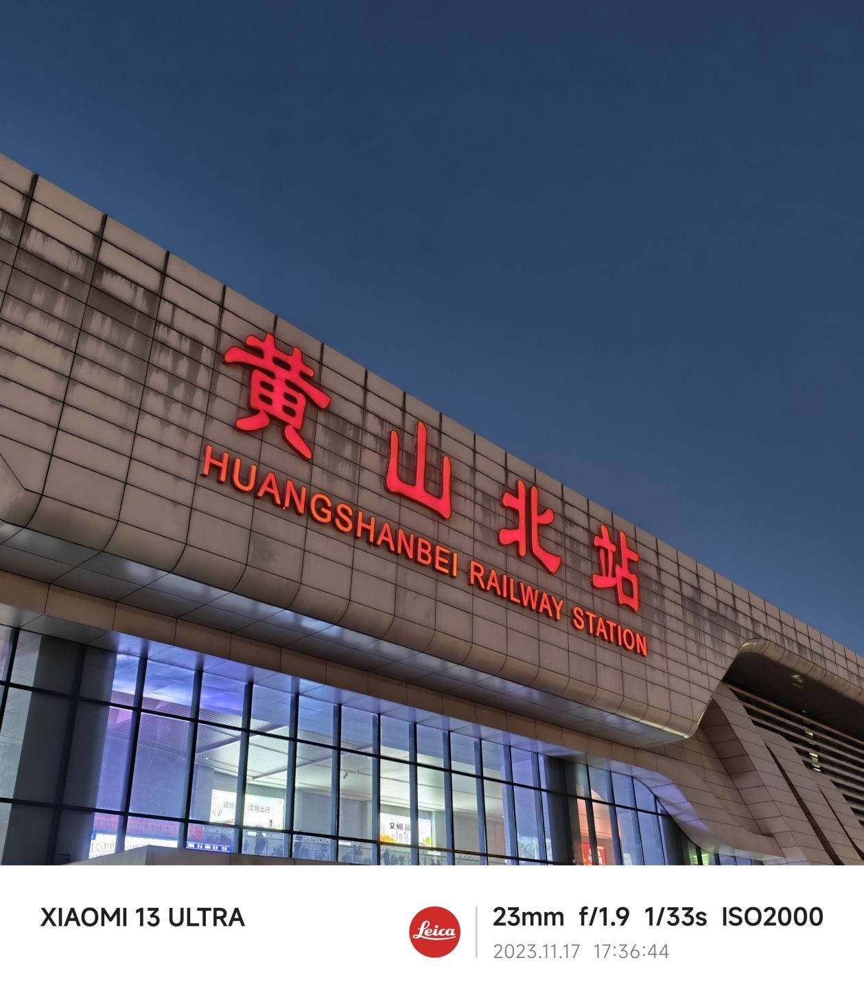
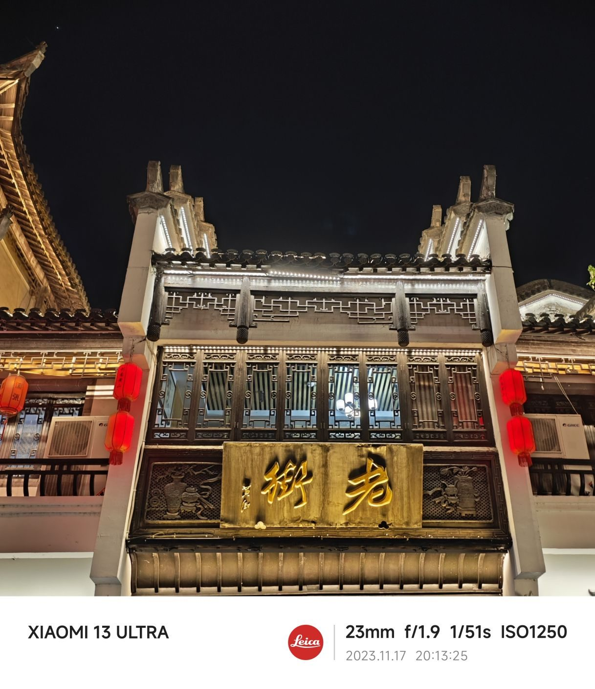
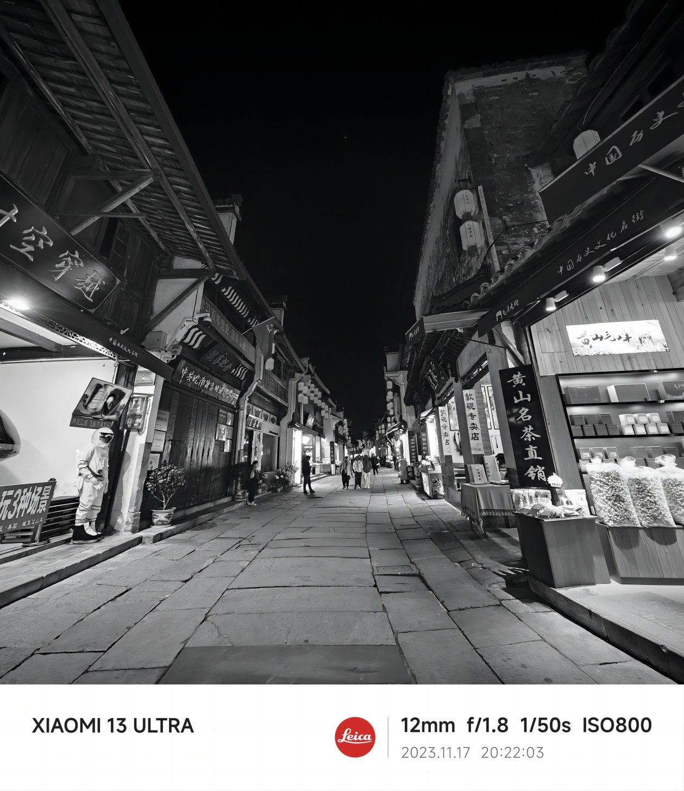
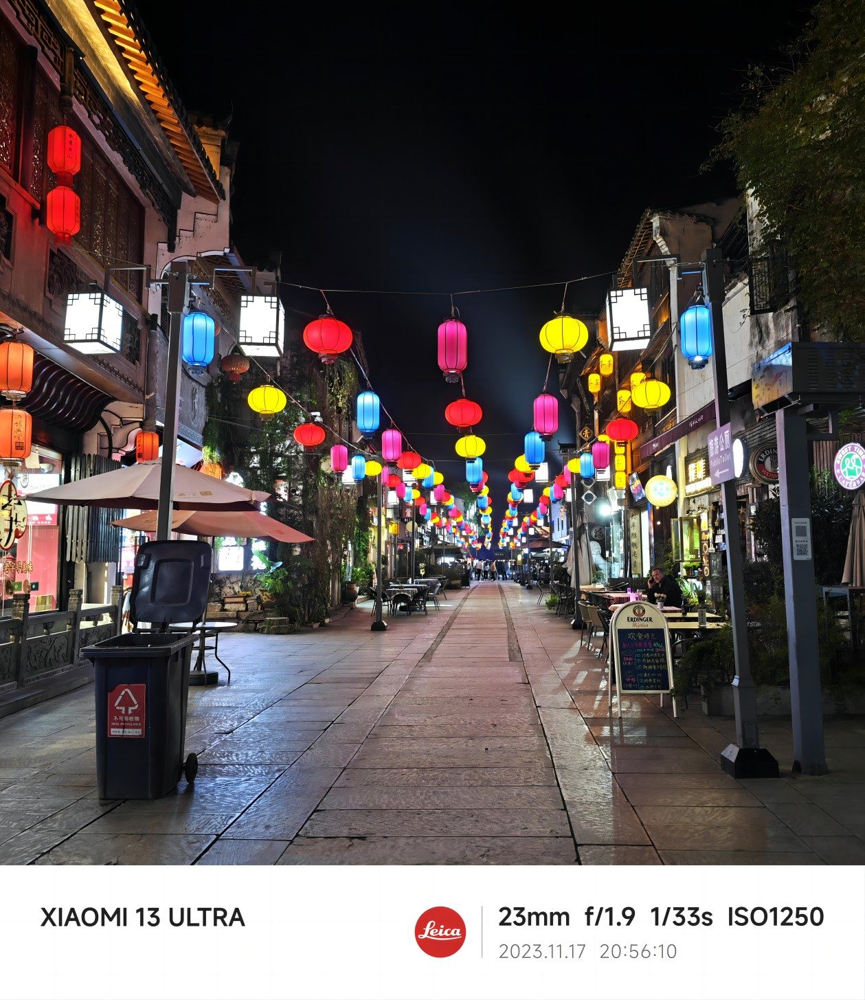

距离国庆去宏村才一个半月，没想到今年我司团建决定去黄山了。

我们是周五下午从虹桥乘高铁出发去黄山，2个半小时的路程还是挺快的。PS：明年这条线路会延长到九华山，这样乘高铁回家应该比现在的线路能快1个小时。

傍晚到达黄山，住宿在离高铁站不远的民宿，连续俩天的晚餐都是民宿老板提供的，除了特色臭鲑鱼，毛豆腐外，也有萝卜炖牛腩这种跟隔壁我们池州平时吃的差不多的徽菜，所以口味都是以咸鲜带一点辣为主，总体大家的评价都是不错的，经过第一天晚餐的反馈，第二天也尽量少放盐了。但由于我司有不少是魔都土著，所以一点点辣还是被吐槽了。（明明安徽的辣味程度已经很低了）

吃完晚餐稍作休整8点左右，我们就先去逛了一下老街，基本上就是一条商业化的古镇一条街，以卖各种特产小吃（黄山烧饼），茶叶以及文创古玩为主。走走逛逛了一个小时，主要以消食为主。当然最后也参与消费，买了烧饼和豆干当零食吃。

最后返回民宿休息，第一天的行程就结束了，第二天就去爬黄山了！尽管上下山都坐了缆车，但像我这种平时上班，下班很少运动的社畜，爬完之后还是感觉腿都快断了..
