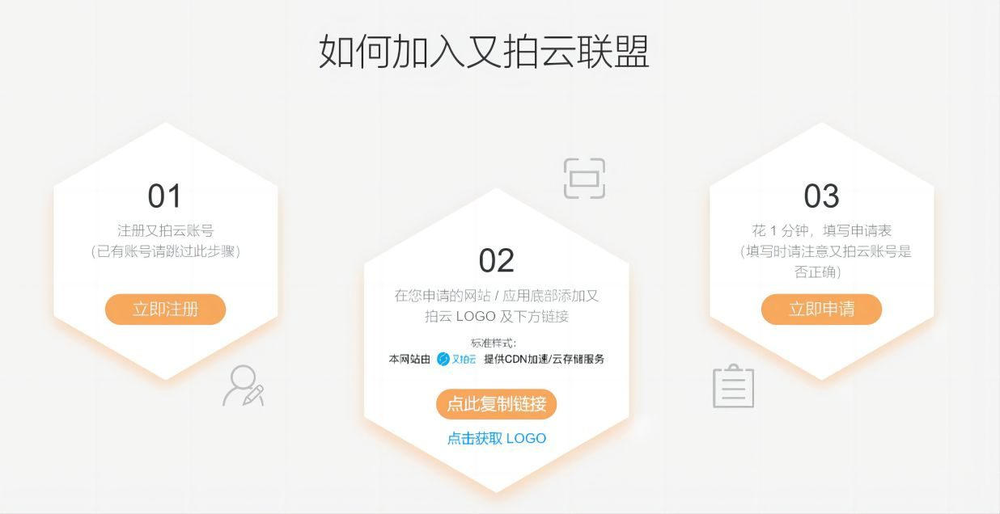
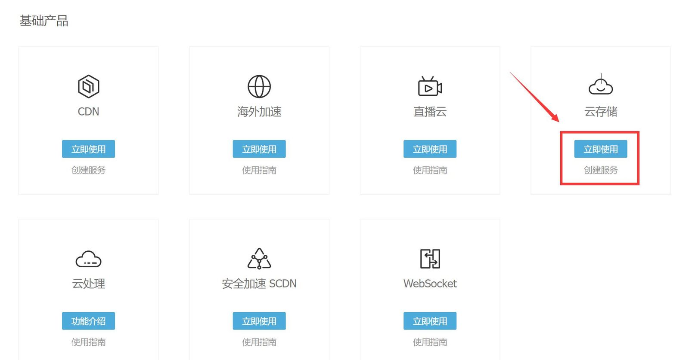
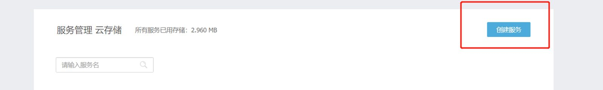
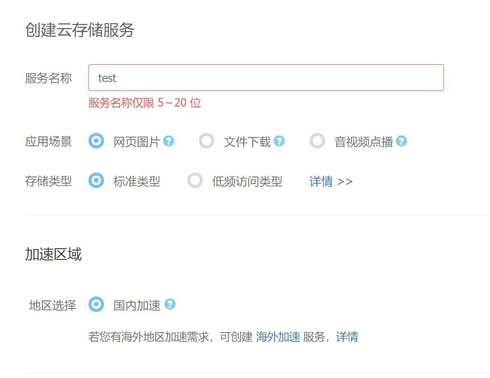
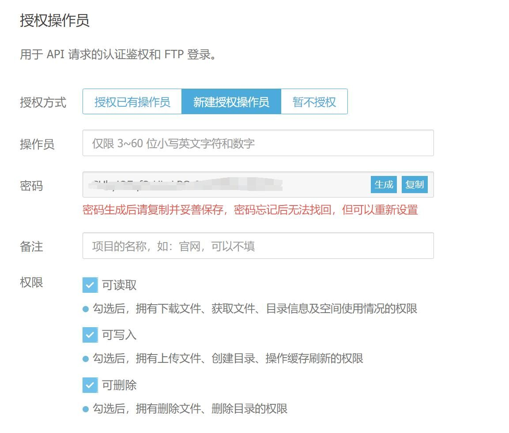
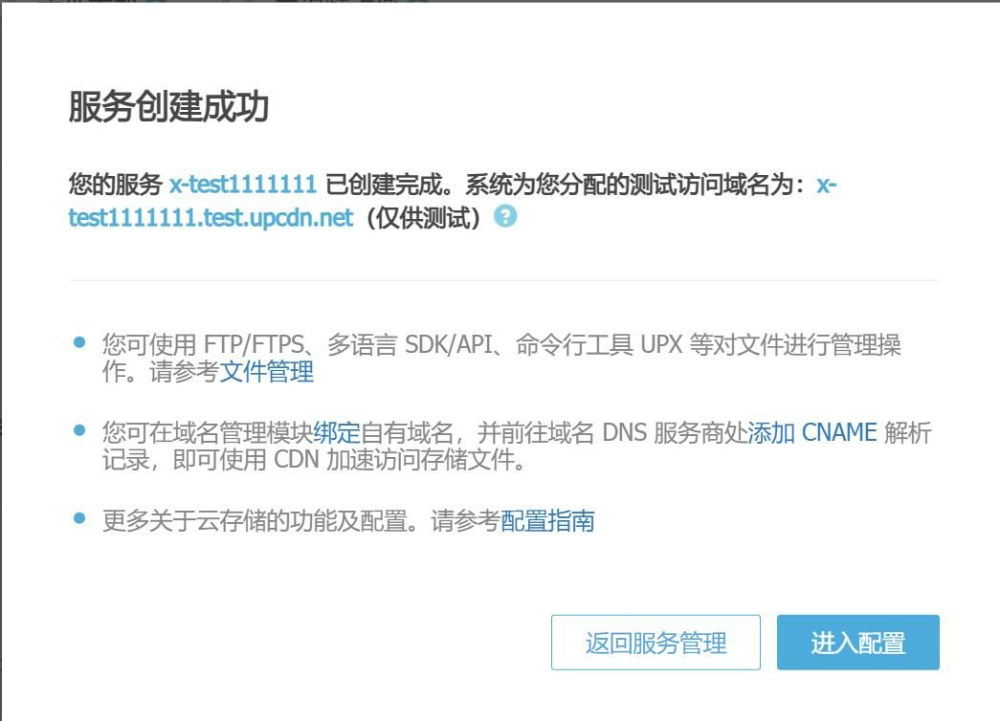
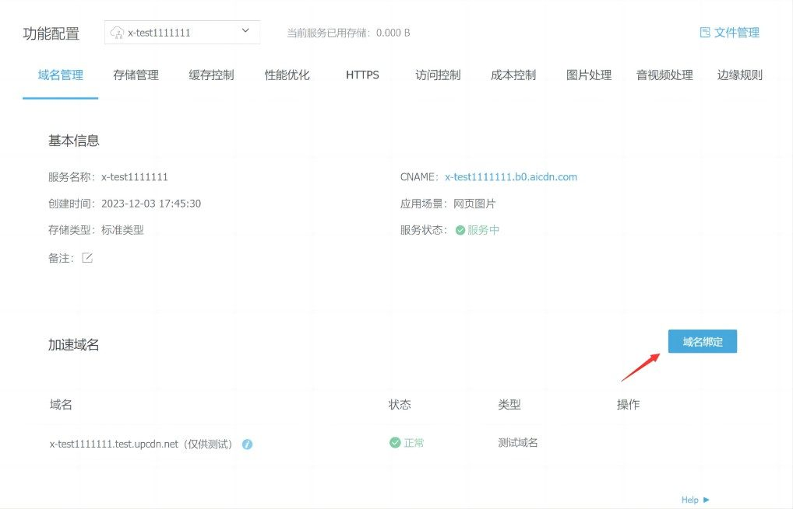
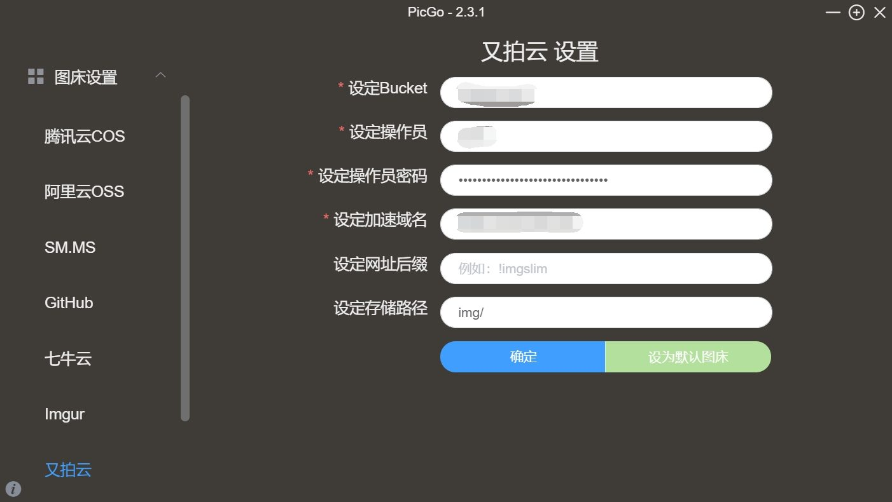
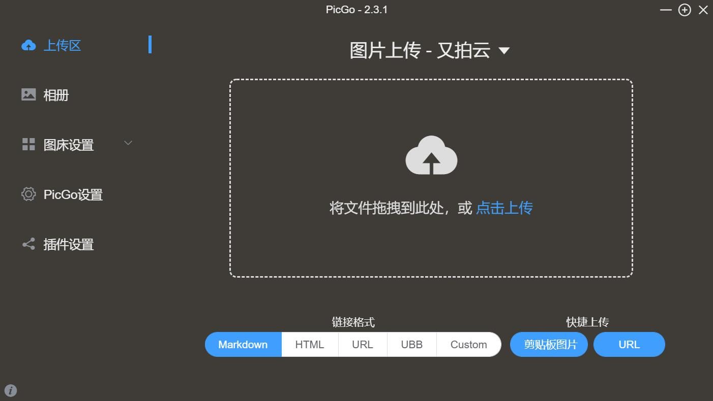

这是本站目前用的图床解决方案，利用的是[又拍云联盟-开发者帮助计划](<https://www.upyun.com/?utm_source=lianmeng&utm_medium=referral>)提供的每月10GB存储空间和15GB流量，可以用于CDN加速和存储服务，这对于个人博客完全够用了。

## 注册并加入又拍云联盟

1.进入又拍云联盟页面，并且按照提示注册账号，并填写申请即可。只要按要求操作，一般审核很快就能通过。   
   
2.完成注册并收到审核通过邮件后，登陆后台，在代金券剩余里可以看到平台发放的1年有效期的代金券，我们使用的数据都会白嫖自动抵扣。   
   
3.首先我们需要新建一个云存储。选择云存储，立即使用。   
   
4.在这里创建服务，名称随意，应用场景选择网页图片。   
   
5.新建管理员,并勾选**可读取、可写入、可删除** ，管理员账号和密码务必记下来，后面PicGo需要用到！   
   
6.创建成功后，会分配测试域名，我们这里进入配置，绑定自己的域名。根据要求去自己域名的运营商那里绑定，需要注意的是这里绑定的域名是需要备案过的。绑定成功后又拍云会有邮件和站内信提醒。   

   
7.至此你的云存储服务就已经创建成功了。接下来就需要利用PicGo程序来搭配使用图床了。

## 下载配置PicGo

PicGo: 一个用于快速上传图片并获取图片 URL 链接的工具 PicGo 本体支持如下图床：

  * 七牛图床 v1.0
  * 腾讯云 COS v4\v5 版本 v1.1 & v1.5.0
  * 又拍云 v1.2.0
  * GitHub v1.5.0
  * SM.MS V2 v2.3.0-beta.0
  * 阿里云 OSS v1.6.0
  * Imgur v1.6.0

github地址: <https://github.com/Molunerfinn/PicGo> 下载地址：https://github.com/Molunerfinn/PicGo/releases/download/v2.3.1/PicGo-Setup-2.3.1-x64.exe

我们这里使用的是windows客户端，下载安装完成后，直接打开程序。 进入图床设置-又拍云。

设定Bucket: 即在又拍云前面创建的服务名称。 操作员和密码：即创建服务时的管理员和密码。 加速域名： 即我们自行绑定的域名。

完成以上配置并设置为默认图床，我们的配置工作就大功告成啦~

回到上传区，我们可以通过直接拖拽电脑里的图片，剪切板及url的方式上传。 上传完成的图片可以在相册里找到，也支持多种链接格式选择。 Enjoy~以上~
