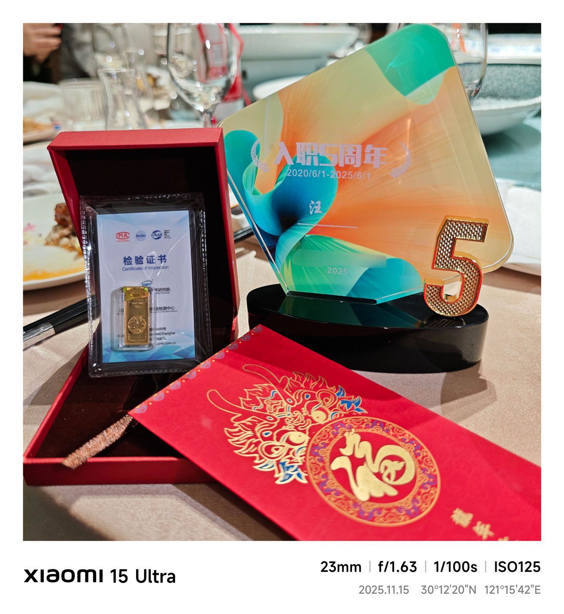
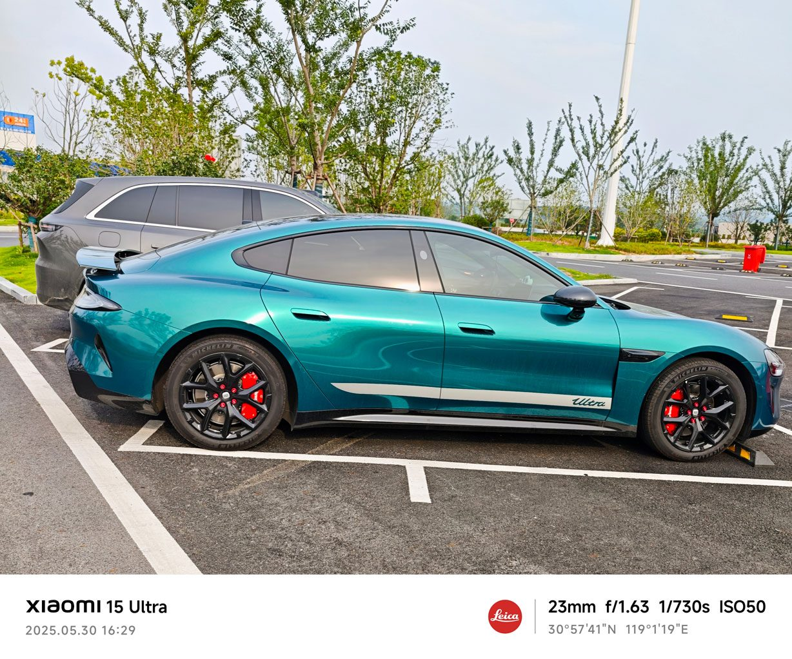
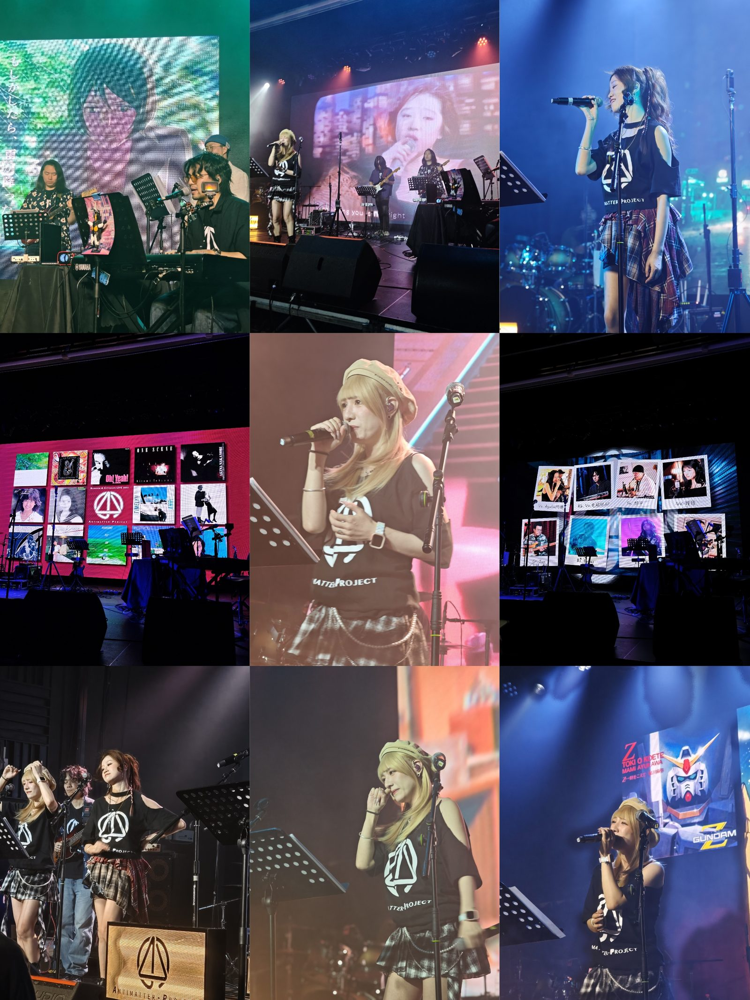

时间过得真快啊，一年这么快就过去了，距离上次的更新还是上次，这次想到什么就写什么吧。

不更新其实也没什么特别的理由，不过就是懒罢了，随着年龄的增长，也越发的没太多表达的欲望。比起同龄人（博主快奔四了），我的生活简直单调的不行，每天就是上班打卡，下班打游戏。因为单身没结婚，所以没什么压力。

今年的工作也凑合，在公司干满5年了，终于拿到了我司五周年的奖励：10克金条*1。说起来这还是我人生第一块黄金，今年金价飞涨，可惜我只在大A当过韭菜，黄金这一块理财还真从来没买过。😂

去年10月底提了辆小米su7，到现在差不多一年多一点，开了大概14000多公里。相对于车友群里看到的那些1年6,7W公里，我开的也不算特别多。一年下来的感受就是，电车比油车可便宜多了，这一年充电大概花了2000左右，折合每公里估计才2毛左右，基本忽略不计了，也难怪大家说电车开到越多越划算。

作为小米车主，这一年也是看着小米汽车从登上山顶，到坠入谷底。小米既享受了雷总带来的巨大流量的红利，最后肯定也要承受来自流量的反噬。面对这一年小米汽车的各种舆论，我也没什么特别的看法，只能说车是好车，但是最终还是看开车的人。

4月份的时候去给车贴了个改色，当时su7ultra刚发布，一眼就喜欢上了ultra的鹦鹉绿色，于是就改了个同款，后来还通过这个车膜门店认识了几位车友，7月份的时候一起约着自驾去了安吉漂流。

今年还参加了几次车友活动，聚餐，回想起来对我这种i人来说也挺不可思议的。

5月份的时候去看了场B站[电磁炮AP](<https://space.bilibili.com/250403247>)大佬发起的city pop的线下live演出，听了非常city pop的经典曲目。（感兴趣的可以通过以下歌曲链接去B站收看，强烈安利）

竹内玛利亚的[plastic love](<https://www.bilibili.com/video/BV1mtkCB3ERH/>)

中森明菜的[oh no,oh yes](<https://www.bilibili.com/video/BV1knKSzCEUZ/>)

当山瞳的[cathy](<https://www.bilibili.com/video/BV1u8nrziEsw/>)

《东京爱情故事》主题曲/小田和正的[突如其来的爱情](<https://www.bilibili.com/video/BV1MtTRzMEgW/>)

下个月平安夜还会开第二场，也买好票了，所以这一次一定会有山下达郎的Christmas Eve了吧。😏

回想起来这一年还挺充实的，大概就这样吧，以上。

PS：下一篇大概会写一下年度好物，毕竟今年也买了不少装备。
